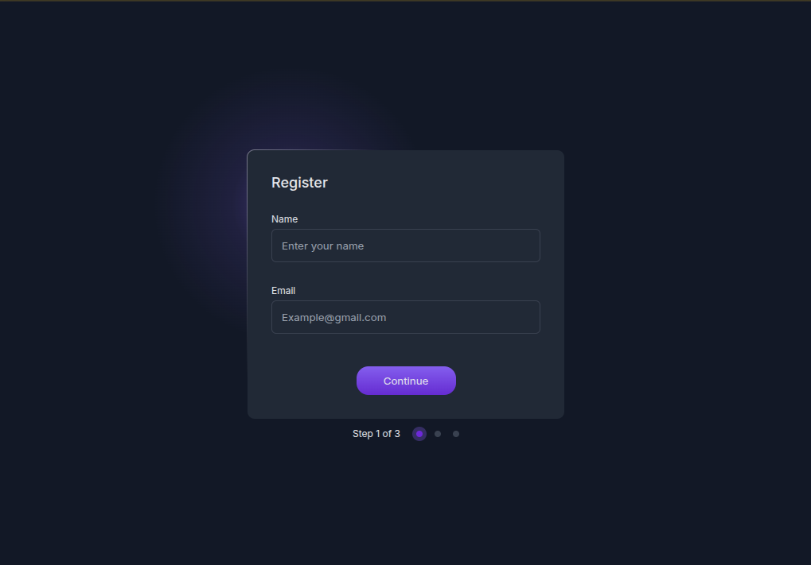

# Multi-step Register Form | devChallenges

   Solution for a challenge <a href="https://devchallenges.io/challenge/multi-step-register-form" target="_blank">Multi-step Register Form</a> from <a href="http://devchallenges.io" target="_blank">devChallenges.io</a>.

  <h3>
    <a href="https://victorricci23.github.io/multistep_register/">
      Demo
    </a>
     | 
    <a href="https://victorricci23.github.io/multistep_register/">
      Solution
    </a>
     | 
    <a href="https://devchallenges.io/challenge/multi-step-register-form">
      Challenge
    </a>
  </h3>

## Table of Contents

- [Overview](#overview)
  - [What I learned](#what-i-learned)
  - [Useful resources](#useful-resources)
- [Built with](#built-with)
- [Features](#features)
- [Contact](#contact)
- [Acknowledgements](#acknowledgements)

## Overview

A multi-step registration form with a clean dark UI and purple accents. The form guides the user through four stages:

1. **Personal data** – name and email with validation  
2. **Topics of interest** – selectable cards (Software Development, User Experience, Graphic Design)  
3. **Summary** – review of the entered information  
4. **Confirmation** – thank-you screen after submission  

The interface includes a step indicator (dots + “Step X of 3”), smooth transitions between steps, and visual feedback when topics are selected.

### What I learned

- Managing multi-step forms with pure JavaScript (show/hide steps, update progress indicator)
- Custom form validation (name normalization + email regex + `setCustomValidity` with localized messages)
- Toggle selection pattern for topic buttons (add/remove from an array + visual active state)
- Dynamically building a summary from collected data
- Creating a modern card look with CSS gradients on borders and a soft radial glow behind the form
- Organizing the code into small, focused functions (`normalizeName`, `normalizeEmail`, `updateSummary`, `nextStep`, `checkStep`)

### Useful resources

- [MDN – Constraint Validation API](https://developer.mozilla.org/en-US/docs/Web/HTML/Constraint_validation) – helped with `checkValidity`, `reportValidity` and custom messages
- [CSS Gradient Border technique](https://css-tricks.com/gradient-borders-in-css/) – used for the subtle light border on the form card
- [Inter font](https://fonts.google.com/specimen/Inter) – clean typography that fits the modern dark theme

### Built with

- Semantic HTML5 markup
- CSS (Flexbox, gradients, transitions, custom properties for colors)
- Vanilla JavaScript (no frameworks)
- Google Fonts (Inter)

## Features

- Multi-step registration flow (3 interactive steps + confirmation)
- Real-time validation for name and email
- Multi-select topics with visual feedback
- Live summary of the collected data
- Step progress indicator with animated active dots
- Dark theme with purple accent colors and soft glow effects
- Responsive layout that works well on mobile and desktop
- Localized validation messages (pt-BR, en-US, es-ES)

## Acknowledgements

Challenge designed by [devChallenges.io](https://devchallenges.io).

## Author

- Coded by **Victor C. Ricci**
- GitHub [@victorricci23](https://github.com/victorricci23)
